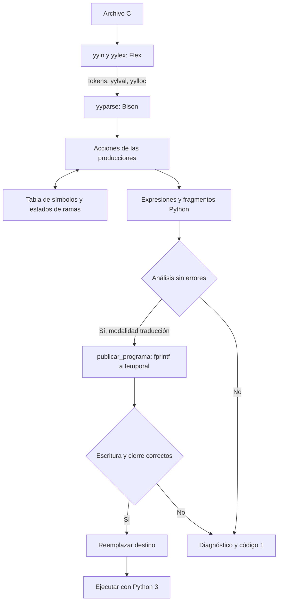

# Arquitectura del transpilador

El proyecto conserva Flex, Bison y C. Cada reducción construye valores
semánticos y fragmentos de Python; después del análisis se escribe el
programa completo. No hay árbol de sintaxis abstracta ni evaluación
anticipada de las expresiones.

## Responsabilidades y flujo

| Archivo | Responsabilidad y comunicación |
|---|---|
| `src/analizador_c.l` | `yylex()` lee `yyin`, reconoce tokens, copia `yytext` en `yylval.texto` y actualiza `yylloc`. Incluye `parser.tab.h` |
| `src/parser.y` | `yyparse()` solicita tokens, aplica producciones y llama a las funciones semánticas. Contiene `main()`, selección de modalidad y decisión de publicación |
| `src/traduccion.h` | Declara `Tipo`, `Expresion`, `Argumentos`, `Estado`, `ContextoIf` y las funciones compartidas. Bison lo incluye mediante `%code requires` |
| `src/traduccion.c` | Implementa memoria, símbolos, comprobaciones, conversiones, fragmentos, indentación y escritura de salida |
| `compilar.sh` | Genera `parser.tab.c/.h` con Bison, `lex.yy.c` con Flex y enlaza ambos con `traduccion.c` mediante GCC |

Con un argumento se comprueban léxico y sintaxis. Con dos se activa la
semántica y la generación. Las funciones consultan `modo_traduccion`
para conservar la modalidad original. En análisis no se publica archivo.

## Recorrido de una declaración

Para `int x = 2;`:

1. Flex devuelve `INT ID ASSIGN INT_LITERAL SEMICOLON`; copia los textos
   `x` y `2`, que dejarían de ser estables si se conservara solo `yytext`.
2. `tipo : INT` entrega `T_INT`. `cabecera_declaracion : tipo ID`
   llama a `declarar_simbolo()` y devuelve un índice.
3. El símbolo se registra antes del inicializador. Por eso
   `int x = x;` encuentra una variable declarada, pero aún no inicializada.
4. `factor : INT_LITERAL` llama a `literal_numerico()`.
   Las reglas `termino : factor` y `expresion : termino` propagan
   una `Expresion` de texto `2`, tipo int y precedencia de átomo.
5. `declaracion` llama a `generar_asignacion()`: convierte si es preciso,
   marca la variable inicializada y devuelve `x = 2\n`.
6. `lista_sentencias` incorpora el fragmento al cuerpo. La indentación
   se añade al formar cada bloque y la función principal.

`int x;` únicamente registra el símbolo. No se traduce como `x = 0`;
leer x antes de una asignación válida es un error semántico.

## Recorrido de una expresión

Después de declarar `x`, la instrucción `x = 2 + 3 * 4;` pasa por
`factor` para cada literal; `termino MULT factor` construye `3 * 4` y
`expresion PLUS termino` construye `2 + 3 * 4`. Finalmente,
`asignacion` busca x y genera la línea correspondiente.

`crear_binaria()` recibe ambos operandos, el operador y la precedencia.
`tipo_comun()` aplica las promociones numéricas y `binaria_texto()`
resuelve la agrupación. No se reemplaza la expresión por 14.

La división de int usa `_c_idiv(a, b)`, porque Python `//` redondea
hacia menos infinito y C trunca hacia cero. El auxiliar divide valores
absolutos y aplica el signo. Convertir a int usa `int(...)`.
Convertir a float usa `_c_f32(...)`, implementado con `struct.pack/unpack`.
También se redondean los resultados de operaciones entre float.
Los literales reales de C se representan internamente como `T_DOUBLE`.
Se incluyen auxiliares solamente si las expresiones construidas los requieren.

## Recorrido de printf

Para `printf("x = %d\n", x);`:

1. Flex entrega `PRINTF LPAREN STRING COMMA ID RPAREN SEMICOLON`.
2. `factor : ID` llama a `referencia_variable()`, que comprueba
   declaración e inicialización y devuelve el nombre Python con su tipo.
3. `lista_argumentos` construye un arreglo mediante `primer_argumento()`
   y `agregar_argumento()`.
4. `llamada_printf` llama a `generar_printf()`.
   `decodificar_cadena()` comprueba escapes; se verifican formatos,
   número de argumentos y tipos; `citar_python()` produce la cadena Python.
5. El fragmento es `print("x = %d\n" % (x,), end="")`.
   La tupla de un elemento lleva coma; `end=""` evita añadir otro salto.
   Los argumentos y la cadena recibidos se liberan tras su uso.

La misma función maneja cadenas sin argumentos y `%%`. No es una
implementación completa de la biblioteca printf de C.

## Tabla de símbolos y ámbitos

La tabla es un arreglo estático de hasta `MAX_SIMBOLOS = 100` entradas
`Simbolo`. Cada entrada guarda nombre C, nombre Python, tipo, profundidad
de ámbito, estado activo e inicialización. No guarda el valor numérico
de las variables.

`entrar_ambito()` aumenta la profundidad. `salir_ambito()` desactiva sus
entradas; no las elimina. `buscar_simbolo()` recorre de atrás hacia
adelante y selecciona el identificador activo más cercano.
`declarar_simbolo()` rechaza duplicados activos en el mismo ámbito.
El sombreado en un ámbito interior se permite.

Python no crea ámbito por cada `if`. Por ello se asigna un nombre Python
único a cada declaración cuando existe conflicto. Los nombres C se
conservan siempre que sea posible; se utiliza `_c_var_N` cuando coinciden
con palabras reservadas de Python, nombres usados por el generador,
el prefijo auxiliar `_c_` o una declaración previa con ese nombre Python.
Esto también impide que una variable oculte `print`, `int` o `float`.

## Inicialización y condicionales

`Estado` guarda los indicadores de inicialización y si el camino actual
es alcanzable. `iniciar_if()` toma una copia del estado de entrada.
Tras el primer bloque, la acción intermedia llama a `preparar_else()`
para guardar su estado y restaurar la entrada antes de analizar la
alternativa.

`terminar_if()` conserva las variables inicializadas en todos los
caminos que continúan; excluye ramas terminadas por `return`. Si no
hay else, también considera el camino que no entró al if.
No calcula condiciones constantes. Una variable inicializada solo
dentro de un if puede rechazarse aunque una persona sepa que la
condición siempre es verdadera.

`generar_else()` y `generar_elif()` forman las alternativas.
`indentar_bloque()` añade cuatro espacios por nivel y usa `pass` si
un cuerpo válido no produjo instrucciones. `generar_return()` convierte
el resultado a int; el programa generado finaliza mediante
`raise SystemExit(main())`. Llegar al final de main produce salida 0.

## Memoria, errores y publicación

Los lexemas se copian en memoria dinámica. Las expresiones y fragmentos
transfieren la propiedad a sus consumidores; estos liberan lo recibido.
Los `%destructor` de Bison cubren valores descartados por errores.
`finalizar_traduccion()` libera los nombres de la tabla.

Hay contadores separados para errores léxicos, sintácticos y semánticos.
Las ubicaciones de Flex permiten diagnosticar línea y columna.
Los fallos de apertura, memoria, escritura o reemplazo también impiden
informar una traducción correcta.

`main()` llama a `publicar_programa()` solamente si `yyparse()` y todos
los contadores indican éxito. Esta función:

1. Rechaza que entrada y salida sean el mismo archivo, incluidas
   identidades de archivo equivalentes en Windows.
2. Crea exclusivamente un temporal junto al destino. El directorio
   de destino debe existir.
3. Declara `FILE *archivo_salida` y usa `fprintf()` para auxiliares
   necesarios, `def main():`, cuerpo indentado y punto de entrada.
4. Comprueba escritura, vaciado y cierre. Solo entonces reemplaza
   el destino con `MoveFileExA`.
5. Ante un fallo conserva el destino previo y retira únicamente el
   temporal creado por esa operación.

Las acciones construyen el texto antes de escribirlo. Es una adaptación
de la generación con `fprintf()` de los ejemplos 03–05 del profesor
que evita dejar una salida parcial cuando falla el análisis.
